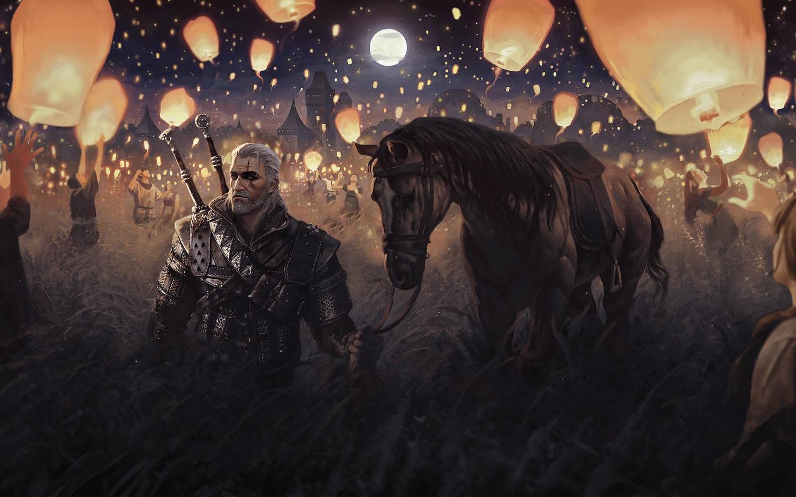

# Witcher Parallax Slider

Полноэкранный горизонтальный слайдер с многослойным параллаксом и анимированными частицами в стилистике «Ведьмака».

**[Демо →](https://fkupme.github.io/project_horizontalScroll/)**



## Что внутри

- **Swiper** с модулем Parallax: каждый слайд собран из 4–5 слоёв (фон, персонажи, передний план), и каждый слой смещается со своей скоростью через `data-swiper-parallax`
- Перелистывание колесом мыши, свайпом и перетаскиванием
- **Частицы на canvas** — свой скрипт (`libs/particles/particles.js`): у каждого слайда свой цвет искр, задаётся через `data-color`
- Медленный переход (`speed: 2400`), чтобы глубина слоёв хорошо читалась

## Стек

HTML, CSS, JavaScript, [Swiper](https://swiperjs.com/), Canvas API

## Запуск

Сборка не нужна — достаточно открыть `index.html` или поднять любой статический сервер:

```bash
npx serve .
```

## Структура

```
├── index.html             # разметка слайдов и слоёв
├── css/main.css
├── js/app.js              # инициализация Swiper
├── libs/swiper/
├── libs/particles/        # частицы на canvas
└── img/screen-{1,2,3}/    # слои для каждого слайда
```
